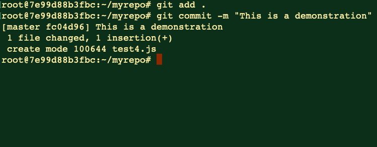
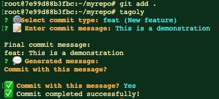
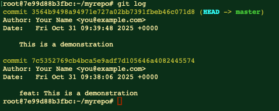

<div align="center">
  <h1>Tagoly</h1>

  <a href="https://www.tagoly-lp.us/">
    
  </a>

<p>
    <strong>A smart Git commit CLI that keeps your commit history consistent.</strong><br />
    Tagoly guides every commit interactively, detects scopes from staged files, and can lint messages in CI.
  </p>

<p align="center">
  <a href="https://github.com/meso1007/Tagoly/releases/latest"></a>
  <a href="https://github.com/meso1007/Tagoly/blob/main/go.mod"></a>
  <a href="https://github.com/meso1007/Tagoly/blob/main/LICENSE"></a>
  <a href="https://github.com/meso1007/homebrew-tagoly"></a>
</p>

<p align="center">
  <a href="https://www.tagoly-lp.us/"><b>Website</b></a>
  &nbsp;&nbsp;︱&nbsp;&nbsp;
  <a href="https://github.com/meso1007/Tagoly-JP"><b>日本語版 (Tagoly-JP)</b></a>
  &nbsp;&nbsp;︱&nbsp;&nbsp;
  <a href="#installation"><b>Install</b></a>
</p>
</div>

<p align="center">
  
</p>

## Why Tagoly

Tagoly streamlines commit writing for teams that want more consistency in commit history without adding process overhead.  
It guides each commit interactively and helps keep scopes and tags structured across repositories.

## Features

- **Automatic scope detection** based on staged file paths (for example, `feature/login`, `docs/readme`).
- **Interactive commit flow** for selecting type, scope, and subject in a clear step-by-step prompt.
- **Smart scope suggestion** when multiple scopes are detected, with manual override when needed.
- **Custom tags** via `.tagolycustom` (for example, `ci`, `perf`, `hotfix`).
- **Commit message linting** for validating team commit rules locally or in CI.
- **Git hook installation** to enforce Tagoly format through `commit-msg`.

## Quick Start

Install Tagoly, stage your changes, then run the CLI:

```bash
brew tap meso1007/tagoly
brew install meso1007/tagoly/tagoly

git add .
tagoly
```

For Windows:

```powershell
scoop bucket add tagoly https://github.com/meso1007/scoop-tagoly
scoop install tagoly/tagoly

git add .
tagoly
```

## Installation

Every release ships prebuilt binaries for macOS, Linux, and Windows on the
[Releases page](https://github.com/meso1007/Tagoly/releases).

### macOS

Homebrew:

```bash
brew tap meso1007/tagoly
brew install meso1007/tagoly/tagoly
tagoly --version
```

Manual install (ensure destination directory is in your `PATH`):

Apple Silicon:

```bash
tar -xzf Tagoly_Darwin_arm64.tar.gz
mv tagoly /usr/local/bin/tagoly
chmod +x /usr/local/bin/tagoly
```

Intel:

```bash
tar -xzf Tagoly_Darwin_x86_64.tar.gz
mv tagoly /usr/local/bin/tagoly
chmod +x /usr/local/bin/tagoly
```

### Linux

Homebrew (Linuxbrew):

```bash
brew tap meso1007/tagoly
brew install meso1007/tagoly/tagoly
```

Manual install (AMD64):

```bash
tar -xzf Tagoly_Linux_x86_64.tar.gz
mv tagoly /usr/local/bin/tagoly
chmod +x /usr/local/bin/tagoly
```

Manual install (ARM64):

```bash
tar -xzf Tagoly_Linux_arm64.tar.gz
mv tagoly /usr/local/bin/tagoly
chmod +x /usr/local/bin/tagoly
```

### Windows

Scoop:

```powershell
scoop bucket add tagoly https://github.com/meso1007/scoop-tagoly
scoop install tagoly/tagoly
tagoly --version
```

Manual install (ensure `C:\Program Files\tagoly` is in `PATH`):

```powershell
Expand-Archive .\Tagoly_Windows_x86_64.zip -DestinationPath .
Move-Item .\tagoly.exe "C:\Program Files\tagoly\tagoly.exe"
```

## Configuration

Create `.tagolycustom` in your repository root to share custom commit types with your team.  
Tagoly checks the repository `.tagolycustom` first, then falls back to `~/.tagolycustom`.

```json
{
  "customTags": [
    { "key": "ci", "label": "CI/CD changes" },
    { "key": "perf", "label": "Performance improvement" },
    { "key": "test", "label": "Add or update tests" },
    { "key": "hotfix", "label": "Hotfix / urgent fix" }
  ]
}
```

### `.tagolycustom` examples

For product teams:

```json
{
  "customTags": [
    { "key": "ux", "label": "User experience changes" },
    { "key": "copy", "label": "Text or content updates" },
    { "key": "experiment", "label": "A/B test or experiment changes" }
  ]
}
```

For platform or infrastructure teams:

```json
{
  "customTags": [
    { "key": "ci", "label": "CI/CD changes" },
    { "key": "infra", "label": "Infrastructure changes" },
    { "key": "perf", "label": "Performance improvement" },
    { "key": "security", "label": "Security-related changes" }
  ]
}
```

Custom tag keys should be lowercase letters because Tagoly commit parsing currently expects the `type(scope): subject` type to use lowercase alphabetic keys.

## Usage

### Create a commit

Stage your changes, then run Tagoly:

```bash
git add .
tagoly
```

Tagoly will guide you through:

- selecting a commit type
- selecting or confirming the detected scope
- entering the commit subject
- confirming the generated commit message

For scripts or agents without a TTY, use `tagoly commit` with flags:

```bash
tagoly commit -type fix -scope frontend -subject "fix CSS class mismatch"
```

If `-scope` is omitted, Tagoly uses the detected scope from staged files.

Generated messages follow this format:

```text
feat(api): add endpoint
fix(auth): handle expired session
docs(root): update onboarding notes
```

### Search commit history

Use `tagoly tagdict` for interactive search by commit type or scope:

```bash
tagoly tagdict
```

Use `tagoly search` when you already know the filter:

```bash
tagoly search -type feat
tagoly search -scope auth
tagoly search -subject login
tagoly search -type fix -limit 10
```

### Validate commit messages

Use `tagoly lint` to check whether commit messages follow the Tagoly format:

```bash
tagoly lint -message "feat(api): add endpoint"
tagoly lint -message-file .git/COMMIT_EDITMSG
tagoly lint -range main..HEAD
```

`lint` returns a non-zero exit code when a message is invalid, so it can be used in local scripts or CI.

### Install the commit hook

Install a `commit-msg` hook to reject invalid commit messages before they enter the repository:

```bash
tagoly install-hook
```

If a `commit-msg` hook already exists, Tagoly will not overwrite it by default. To replace it:

```bash
tagoly install-hook -force
```

The installed hook runs:

```bash
tagoly lint -message-file "$1"
```

This is useful for teams because developers can still write commits manually, while the repository keeps the same commit format.

## Before / After

| Manual Commit | Tagoly |
| :--: | :--: |
|  |  |

### Git Log Comparison

<p align="center">
  
</p>

## Related Repositories

- [meso1007/Tagoly](https://github.com/meso1007/Tagoly) — this CLI (English)
- [meso1007/Tagoly-JP](https://github.com/meso1007/Tagoly-JP) — Japanese version
- [meso1007/Tagoly-LP](https://github.com/meso1007/Tagoly-LP) — official landing page
- [meso1007/homebrew-tagoly](https://github.com/meso1007/homebrew-tagoly) — Homebrew tap
- [meso1007/scoop-tagoly](https://github.com/meso1007/scoop-tagoly) — Scoop bucket

## Contributing

Issues and pull requests are welcome. See [CONTRIBUTING.md](./CONTRIBUTING.md) for development setup and commit conventions.

---

If Tagoly helps your workflow, a star is always appreciated.
